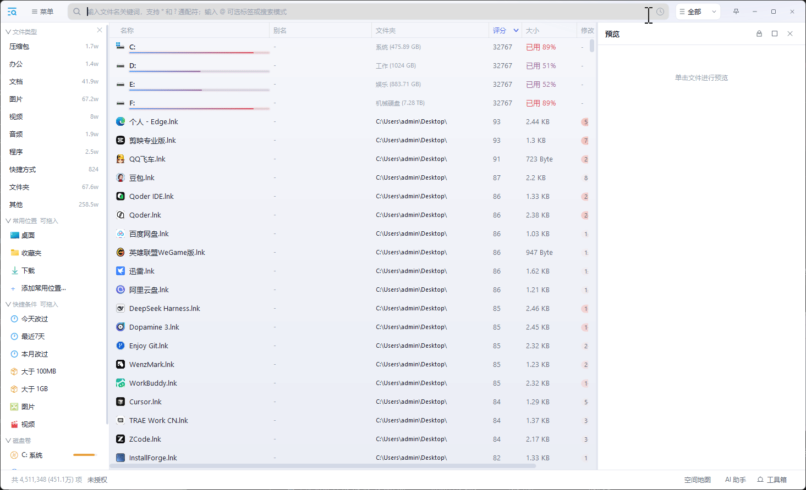
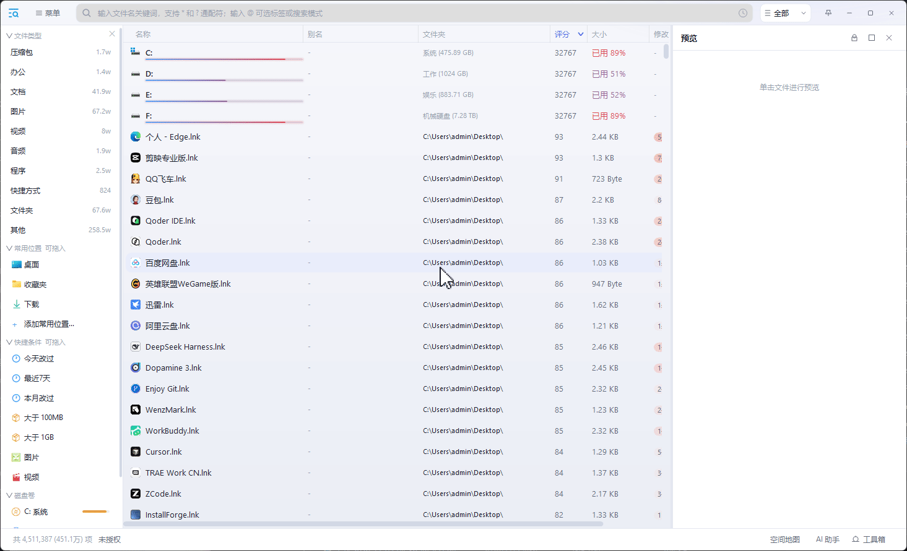
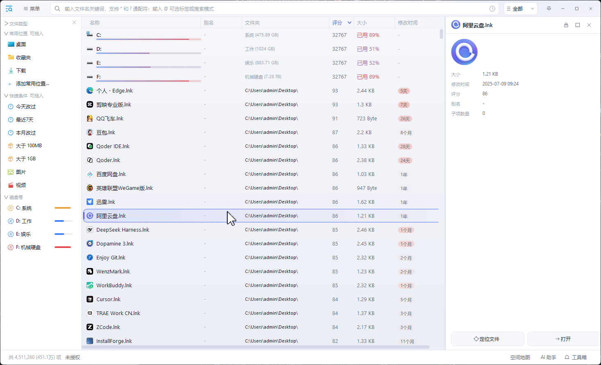
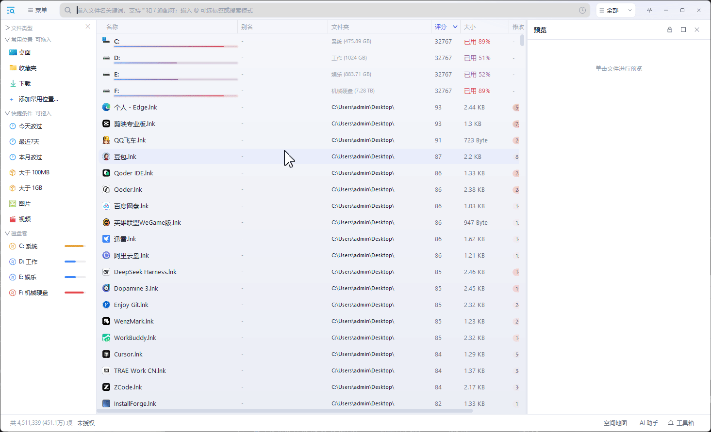
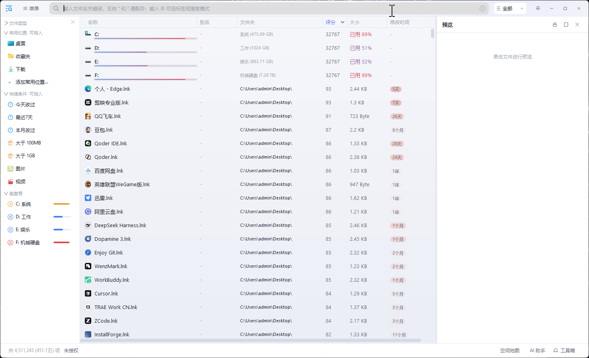
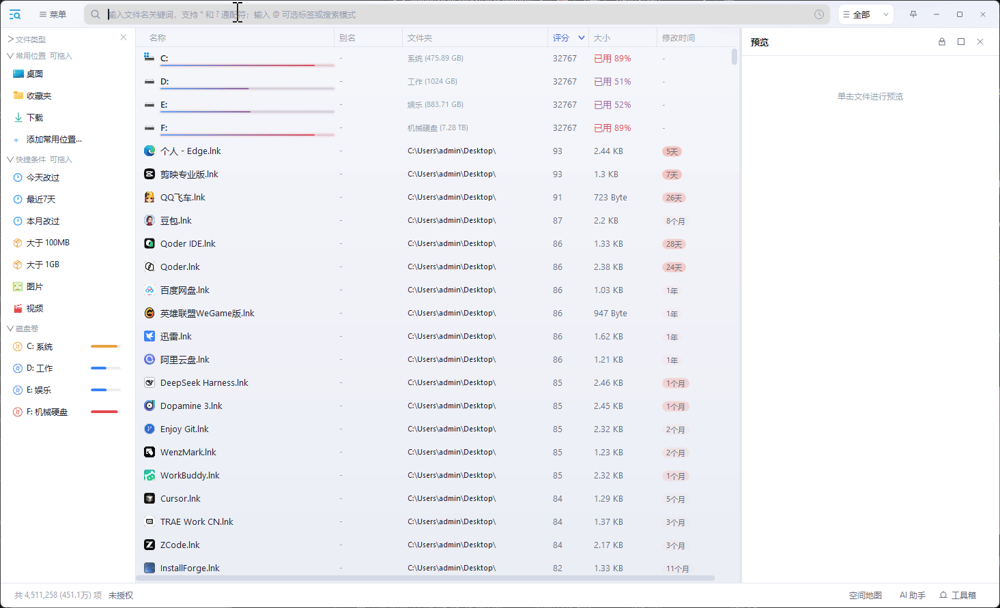

#  蜗牛快搜 SnailQuickSearch

**Windows 本地文件即时搜索工具** —— 全盘索引、输入即搜、秒级定位,常驻内存更低。纯 Direct2D 全自绘界面,内置可编程插件系统。

[](#-系统要求)
[](#-从源码构建)
[](#-界面与交互)

---

## 🗣️ 一句话就能调起全部功能

**打一个 `@`,然后说人话。** 同类工具要你先背一张语法表(`size:>100m`、`!ext:`、`dateaccessed:`…),这里是把需求直接念出来:

```text
@一句话:最近半年下载的视频,把重复的列出来
@一句话:桌面里有多少个文件
@一句话:最占地方的前10个目录
@一句话:里面写着TODO的文件
@一句话:入秋以后拍的照片,按月份分组
@一句话:文件夹里有3个视频,按大小排序
```

`@一句话:` 是一颗**拆句胶囊**:它自己不参与搜索,而是每敲一个字就把这句话当场拆成普通条件胶囊(时间 / 格式 / 大小 / 路径 / 名字特征 / 正文 / 属性 / 包含 / 层数 / 统计 / 分组 / 排序),拆出来的东西排在它后面,**一颗颗看得见、点 ∨ 能换值、能手改**。

| 想干什么 | 直接这么说 | 落成哪一档 |
|---|---|---|
| 按名字、按地方 | `桌面的扫描件` · `D盘里的视频` · `除C盘外` | `@文件名:` `@路径:` |
| 打拼音 | 直接打 `wd` / `wendang` | 通配符模式内置,连高亮一起 |
| **搜文件正文** | `里面写着TODO的文件` · `提到预算的文件` · `内容不含水印` | `@文件内容:` |
| 时间 | `我老婆昨晚下载的` · `三年没动过的文件` · `国庆那七天` · `入秋以后` | `@创建/修改/访问时间:` |
| 大小 | `几十兆的视频` · `一个半G以上` · `空文件` · `三四百兆` | `@大小:` |
| 格式 | `图片以外的其他都要` · `安装包` · `4K的电影` | `@扩展名:` |
| 属性与评分 | `隐藏文件` · `只读的文件` · `评分4以上的` | `@属性:` `@评分:` |
| 目录里装着什么 | `文件夹里有3个视频` · `没有视频的文件夹` · `2到5个视频的文件夹` | `@包含:` |
| **数一数** | `每个文件夹里有多少个图片` · `C盘有多少视频` · `统计视频总大小` | `@统计:` |
| **分组 / 查重** | `重复文件,至少3份` · `哪种格式最多` · `按月份分组` · `哪些目录最占地方` | `@分组:` |
| 目录结构 | `第三层的文件夹` · `C盘一级目录` · `子文件数大于100的目录` | `@层数:` `@目录计数:` |
| 排序 | `按大小排序` · `以修改时间倒序` · `从旧到新` | `@排序:` |
| 兜底(人话装不下的) | 手写 `@SQL:SELECT … ORDER BY … LIMIT 20`,或换 5 种搜索模式 | `@SQL:` |

三条口径:

- **读不懂不猜**:卡住的那**几个字**标红,状态栏说明是哪里没读懂、给出能照抄的写法,已经认出的部分照常生效。改对即刻恢复。
- **客套话不进搜索词**:`帮我` `麻烦` `请` `捞出来` `我记得` `谢谢` 先剥掉;句子里夹主语也照收(`昨天我下载的视频`),因为查哪一列由**动词**决定。
- **它是本地规则解析器,不是大模型**:你说的原话、文件名、正文片段都不出这台机器(见「隐私与本地运行」)。

手写同样全放开:打 `@` 弹出全部档位清单(继续打字即过滤、`↑↓` 挑、`Enter` 接受),`@分组:扩展名` 与 `@一句话:按扩展名分组` 得到的是同一颗胶囊;插件还能往这张清单里加档。全部人话写法见 [搜索条件说明.md](源码/文档/搜索条件说明.md),第一次用先看 [快速上手.md](源码/文档/快速上手.md)(内置《使用说明》里同样有这几页,顶部页签切)。











## ✨ 特性一览

- **输入即搜** —— 打字的同时出结果,无防抖延迟;过期查询由引擎自动丢弃。
- **全盘索引** —— 文件名/路径/大小/时间/属性走索引库,数百万文件规模依然流畅;首建后增量维护。
- **内存占用极低** —— 同规模全盘索引下低于 Everything 1.5 与 Listary v7:451 万文件实测,专用工作集 281 MB vs 377 MB / 395 MB(见「资源占用实测」)。
- **搜正文** —— 打开文件读里面的字,命中处贴在结果行下方(见「搜正文」)。
- **分组与查重** —— 一棵可展开的组树 + 一张饼(见「分组与查重」)。
- **统计** —— "有多少个 / 加起来多大"变成一列,并按它排(见「统计」)。
- **五种搜索模式** —— 通配符 / 正则 / SQL / Lua 过滤 / Lua 执行,人话说不出的都在这儿兜底(见「五种搜索模式」)。
- **多搜索窗口** —— 一个进程多个窗口,每窗独立的视图、皮肤、缩放、搜索模式、列布局与全局热键。
- **插件系统** —— 清单 + 原生 DLL 双件式;菜单/搜索模式/右键菜单/预览/状态栏/侧栏分组/事件订阅均可扩展;新插件默认禁用、启用需确认;侧栏分组可折叠、可拖动排序、可接收从资源管理器拖进来的文件或文件夹。
- **多语言界面** —— 简体中文、繁体中文、English、한국어、ไทย、Bahasa Melayu,可每窗独立设置。
- **预览面板** —— 图片、文本、Markdown、PDF/EMF、媒体、驱动器空间一览,选中即预览;分组时另出一张饼图。
- **文件操作全套** —— 行内重命名(F2)、设置别名、剪贴板剪切/复制/粘贴、OLE 拖出文件、把文件/文件夹拖进侧栏分组、定位与打开。

## 📄 搜正文(文件内容搜索)

索引只管元数据,正文**不入库**:要查里面的字,程序当场打开文件读。所以它慢,但它是"找到那份东西"的关键一环。

- **三种入口**:打一颗 `@文件内容:合同`;一句话里说 `里面写着TODO的文件`;按 `F3`(或点搜索框左端放大镜)在模式菜单里把**搜索对象**从「文件名」切到「文件内容」,框里的普通词就按正文解释(占位提示与状态栏同时换成内容口径)。
- **命中片段**:查正文时每一行下面让出一条片段带,写「第 N 行」和命中处的上下文,命中的词高亮、上下文退一档颜色;不用双击打开文件去 Ctrl+F。
- **进度看得见**:状态栏「已扫描 x/y · 已找到 n」;把状态栏关掉时,搜索框底缘自动出现一条细进度条——几十秒的搜索不会看着像程序死了。
- **先筛后读**:链是逐段收窄的,**读正文那一段永远排在最后**,只对前面筛剩下的少量文件开文件。所以 `@路径:下载 @文件内容:合同` 比裸查正文快一个量级;没限定范围时右下角会引导你去 设置-搜索匹配 收窄。
- **范围闸**:设置-内容搜索限制 = 白名单(只读这些)/ 黑名单(这些一律不读)/ 每条规则各自的体积上限(内置 200 MB);回收站、系统目录与各类包缓存默认不读。改完即时生效,不用重建索引。
- SQL 里的 `MD5(FileContent)` 走的也是这条流式读取。

## 🧮 分组与查重(`@分组:`)

值是一句**说法**,不是 SQL:`扩展名` / `类型` / `文件名` / `父文件夹` / `路径` / `大小` / `大小区间` / `评分` / `别名` / `内容` / `盘符` / `首字母` / `重复` / `重名` / `同大小`,日期维写 `修改日期=天|周|月|年|小时`。同义词折成同一维(`后缀`=`扩展名`、`上级目录`=`父文件夹`、`打分`=`评分`),介词与动词随意(`把X归类` `按X划分` `X怎么分组`)。

- **查重按内容(MD5)**:`重复文件` `帮我查重` `清理重复` `内容相同` `一模一样` `副本` 全部折成逐个打开算哈希——全库一趟几十秒起步,但同名不同内容不会被误当重复。只要元数据快筛就点名 `重名的文件` / `一样大的文件`(几十万文件秒出,**同名 ≠ 内容相同**)。
- **顺手挂参数**:份数阈值 `重复,至少3份`、只列前几名 `父文件夹,前10组`、组行怎么排 `按总大小` `按份数` `按时间` `按名称`(前置、后置、逗号隔开都算同一颗胶囊:`至少3份的重复文件` = `重复文件,至少3份`)。
- **说了"分组"没点维度** → 默认按时间(`@分组:修改日期=天`),那一列没开索引就顺着退(创建 → 访问),三列都没开才退到父文件夹;点了名的永远按点名的走。
- **列表变一棵树**:一行 = 一组,点任意位置或按 `→` 展开成成员行,成员是一个个真文件(选中、打开、预览、改名、删除照常);组行本身不是文件,所以不可选中也不参与改名。**有多少成员就展开多少行**,列表是虚表,几十万成员也照列。
- **预览面板画一张饼**:这一轮有聚合结果就画,只列前 10 名、其余并成「其他」,片上标百分比;上面一排小钮切口径(按文件数 / 按目录数 / 按空间 / 按空文件)。点切片或图例 = 列表跳到那一组并挪到靠上位置;展开过的组在饼上描一圈白弧、图例行留蓝条。
- **分组段恒在链尾**,所以前面摆 `@路径:D盘` 就把查重限在 D 盘;问"有多少种""都在哪些目录"也算分组(`有多少种格式` `图片都在哪些目录` = 给你一棵组树,组行的个数就是答案)。
- 一句里点两维(`重复文件,按月份分组`)会红字让你挑一个——两段叠着算出来的数谁也不是;要多键 `GROUP BY` 请用 `@SQL:`。

## 📊 统计(`@统计:`)

`@包含:` 只回答"里面有没有",`@统计:` 把数量变成**一列数字**:结果列表多出「统计结果」列(`视频数量:128`),值 = 与 `@包含:` 同一段内层条件(`文件` `视频` `大文件` `大于100M` `隐藏文件` `昨天下载的` `名字含中文`…)。

- **口语里问"有多少"就是这颗**:`看看这个文件夹有多少视频` `C盘有多少视频` `统计每个文件夹里有多少个文件`;主体后面挂 `的数量` `的个数` 是同一句话(`统计视频和程序的数量`)。
- **换成"加起来多大"**:`统计视频的总大小` `文档占多大地方` 出求和列,显示成 `1.2 GB` 这样,照样能拿去排。
- **要不要按它排由你说了算**:点 ∨ →「按数量排序」,或写 `@统计[数量]:视频`(多的在前)/`@统计[数量升]:视频`;没钉就只数不排。列名就是 `主体 + 数量`,一句话里可以直接点名(`按视频数量排序`,只说 `按视频排序` 也认)。
- **多主体各出一列**(`视频和文档` → 两列),但一个方向只认第一列;带个数的说法(`3个视频` `很多文件`)仍归 `@包含:`,写进这颗会红字。
- 只数**直接子项**、只留目录;数字是这一趟算完的快照,子项增删改名不会自动重算父目录,重跑即刷新。

## 🔍 五种搜索模式

| 模式 | 搜索词示例 | 一句话定位 |
|---|---|---|
| 通配符(关键词) | `*.txt`、`文档`、`wd` | 日常默认:星号/问号 + 拼音首拼/全拼 + 且/或组合 |
| 正则 | `^[0-9]+$` | PCRE2 正则,精确控制匹配规则 |
| SQL 语句 | `SELECT Path FROM alltable WHERE Size > '100M'` | 类 PostgreSQL 复杂查询,功能最强 |
| Lua 过滤 | `f.ext() == "pdf"` | 逐文件谓词过滤,可编程的"是否命中" |
| Lua 执行 | 完整 Lua 程序 | 脚本完全接管搜索:自己遍历、自己排序 |

通配符模式内置**拼音搜索**(首拼 `wd`、全拼 `wendang` 均命中"文档")、**多关键词组合**(空格=且,`|`=或)、**自动加星**,另有三档容错开关:简繁互搜、英文混合缩写(`dsh` 命中 `DeepSeek Harness`)、同音别字(`的`↔`得`,推荐"无准确结果时才启用"这一档——精确与好用兼顾)。SQL 与 Lua 的能力边界见 [搜索模式简介.md](源码/文档/搜索模式简介.md)。

## 🍜 好用的姿势

下面前四组代码块里的每一行,都是**直接打在 `@一句话:` 后面的原话**(以 `@` 开头那行是等价的手打胶囊链);后两组是入口与复用姿势。不用记格式,照着念就行。

**清理磁盘**

```text
哪些目录最占地方                 ← 组树 + 饼图,一眼看出该删哪
重复文件,至少3份                 ← 照片/安装包清重
三年没动过的文件,按大小倒序        ← 压箱底的先删
空文件                            ← 顺手清掉垃圾
大于1G的安装包
```

**找资料**

```text
@路径:下载 @文件内容:合同          ← 先缩范围再读正文,快一个量级
里面写着TODO的文件
提到预算的文件,最近3个月修改过的
文件名是数字开头的,并且包含中文
帮我找出和广场舞有关的视频
```

**照片与视频**

```text
入秋以后拍的照片,按月份分组
昨天下载的,按天分组               ← 组键右边带一枚"多久之前"的时间徽章
4K的电影,按大小倒序
图片都在哪些目录                  ← 按父文件夹分好的组树
```

**摸清目录结构**

```text
C盘一级目录
子文件数大于100的文件夹            ← 引擎现算的目录计数
文件夹里有3个视频                  ← `@包含:` 数的是直接子项
文件夹里有5个文件,每个文件体积大于5M  ← "每个…" 并进同一组条件,不另起一颗
没有子文件夹的目录                 ← 空目录
```

**在别的程序里用**

- 任何程序的**打开/保存对话框**一出现,`file-dialog` 插件就把搜索窗钉在旁边并置顶跟随;对话框的「文件类型」自动变成一颗 `@扩展名:` 胶囊,双击或回车把选中集填回去。
- 浏览器链接、Win+R、批处理用 `snailsearch://` 直接唤起搜索(见「URL 协议」)。
- 双击 Ctrl 唤起目标窗口,每窗可录一个独立全局热键。

**把常用那句变成一键**

- **一句话收藏**:在 `@一句话` 胶囊上右键 → 添加到收藏,把具体路径写成占位符(`{路径}` `{父目录}` `{文件名}` `{扩展名}`),之后**右键任意文件/文件夹 → 一句话收藏**就能对它执行。例:收藏 `{路径},按时间进行分组`(目标=文件夹)= 对任意目录一键按时间分组。
- **触发词典**:不认识的词可以自己教——`Config\一句话词典\` 下按大类放 `.json`(随包带示例),教过以后 `简历.docx` 这类说法直接命中。
- **侧栏快捷条件**:把常用的那颗胶囊按住拖出搜索框、丢进侧栏「快捷条件」就钉住;重命名/换序/移除都随你。
- **URL / 插件 / SQL / Lua**:搜索框表达不了的,`ms=` 链接能把整条胶囊链传进来,SQL 与 Lua 能表达任意条件。

## 🌐 隐私与本地运行

- **本体(宿主 + 搜索引擎)完全不联网**:全盘索引、搜索、`@一句话` 拆句全是本地代码;没有账号体系、没有遥测、没有"匿名使用统计",断网时功能完整。
- **`@一句话` 不是大模型**——这一点是"零外发"的根因:接大模型搜索就得把你的原话(连带文件名、路径、正文片段)发给外部服务器,这条链路在本体里不存在。
- **正文只在你要查正文的那一刻被打开读取**,不上传、不另存副本,读取范围还受「内容搜索限制」那道闸约束。
- **AI 助手是可选插件**:装了也要你自己填模型端点与密钥才开始工作(密钥加密存放、绑定当前 Windows 用户与本机),联网搜索是设置里的开关;不装它,以上全部搜索能力一点不少。

## 🎨 界面与交互

- 纯 Direct2D 全自绘 UI(没有一个原生子控件),另提供 **GDI+ 兼容渲染引擎**可选,重启生效。
- 18 款内置皮肤主题一键切换;往 `skin\` 放一条 `skin-<名>.css` 就多一款。列表/详情/大图标等视图档位,列可拖动换位、调宽、显隐,按字段名持久化。
- 搜索框支持输入历史导航(Alt+←/→)、托管标签胶囊链、搜索模式药丸菜单(点放大镜或按 `F3` 打开)。
- 文本输入区支持 `Ctrl+Shift+←/→` 按词选中;拖选期间编辑会结束拖选,多行粘贴保留原有换行而不增添空行。
- 全局呼出:双击 Ctrl 唤起目标窗口、每窗可录制独立全局热键、托盘常驻。
- 每窗可配置:失焦行为、激活落点(跟随鼠标/九宫格落点)、置顶图钉、任务栏图标、单双击打开、默认选中首项等。重建索引完成后,各个已打开窗口会按各自当前输入重新搜索。
- 鼠标滚轮/Ctrl 组合:切换视图、缩放预览、页面缩放 50%~200%。

## 🧩 插件

插件为 `manifest.json` + DLL 双件结构,声明式能力(菜单、搜索模式)无需写代码,动态能力用纯 C ABI SDK 开发:

```text
plugins/<插件id>/
  manifest.json    ← 能力声明(中文主键)
  <插件>.dll        ← 可缺省;纯声明式插件可以没有 DLL
```

- 插件没有沙箱(诚实口径):原生 DLL 与主程序同地址空间同权限,防线是"新插件默认禁用 + 用户只装可信来源"。清单与边界都经过校验(如 `动态库`/图标路径越出插件目录即拒载)。
- 内置示例插件(见 [插件示例/](插件示例/)):
  `space-map` 驱动器空间地图 · `common-places` 常用位置(侧栏钉住常去的地方: 文件夹与文件都收, 从资源管理器直接拖进来、右键列表项添加、右键侧栏项上移/下移/移除;点文件夹 = 限定在它里面搜,点文件 = 直接打开) · `volumes` 磁盘卷(真实容量条 + 点一下限定该盘搜索) · `type-stats` 文件类型统计 · `top-folders` 结果目录 · `quick-filters` 快捷条件(侧栏点选常用条件; 在搜索框任意一颗胶囊上右键 = 把你常用的那颗也钉进来, **按住胶囊拖出搜索框丢到这一组上**也行, 从记事本选中一段文字拖进来也行; 每一条都可重命名/换序/移除) · `saved-searches` 保存的搜索 · `ratings` 评分收藏 · `open-folders` 打开的文件夹 · `file-dialog` 文件对话框集成(任何程序的打开/保存对话框**一出现就自动弹出**名为「文件对话框跳转」的宿主搜索窗口,**钉在该对话框旁边并置顶、跟随它移动**(够宽贴上/下沿同宽, 对话框太窄就改贴左/右沿与它等高, 不被同宽压成一条);也可在文件列表里直接输入唤起(不占用全局快捷键), `@` 胶囊与 `@一句话` 全是现成的; 对话框里的「文件类型」自动变成一颗 `@扩展名:` 胶囊预置在搜索框里(选中的不是"所有文件"就照它, 选中的正是"所有文件"就把下拉里全部类型并起来), 省得手动筛掉没意义的; shell 的「浏览文件夹」目录树也认(按 shell 模板里写死的控件编号识别，不看标题文字)，但只有确定按钮写着「选择文件夹」这种**确证**才预置 `@扩展名:文件夹` —— 同一套模板也能连文件一起选(标题常写「浏览文件或文件夹」)，分得出来才筛，分不出就不动你的列表; 选中结果后双击或回车就把当前选中集交给对话框并确认(多选一次填入, 只填不确认用右键「填入文件对话框」); 对话框识别由**插件自己**观察(宿主不代劳、也不提供这类 API), 不注入目标进程, 32/64 位对话框都能用) · `sql-generator` SQL 生成器 · `ai-assistant` AI 助手。
- 装了带"托管标签"的插件后,`@` 清单里会多出它家的档(例如 `@打开的文件夹:`),用法与内置档**完全一样**。
- 开发入门见 [插件开发指南.md](源码/文档/插件开发指南.md)。

## 🔗 URL 协议(snailsearch://)

在 **设置 - 通用 - URL 协议** 打开开关后,浏览器里的链接、Windows 运行框(Win+R)、资源管理器地址栏、批处理脚本或任何其它程序都能直接唤起搜索:

```text
snailsearch://new?q=报告&filter=文档&sort=修改时间&order=desc   ← 新窗口搜"报告",只看文档,按修改时间倒序
snailsearch://search?q=*.log                                  ← 就在已打开的窗口里搜,不再建新窗
snailsearch://focus                                           ← 只把窗口唤回前台
snailsearch://new?q=演唱会&filter=视频&preview=1&save=1&win=影音  ← 建一个名为"影音"的持久窗口
snailsearch://search?reveal=C:\Tools\readme.txt               ← 在资源管理器里定位这个文件
```

- **动作**:`new`(= `open`)建窗或用 `win=` 复用同名窗口档案 · `search`(= `find`)唤起已有窗口并就地应用参数 · `focus` 唤起主窗口。带参数的 `focus`/`search` 会把参数应用到那扇窗,不会偷偷新建窗口。
- **搜索**:`q` 关键词 · `ms` 多重搜索链(JSON,每段可各自指定模式;段也可以写成 `{"路径":"D:\\电影"}`,直接得到一颗 `@路径:` 胶囊 —— 资源管理器右键那条菜单就是这个形状;**整段编码后传入,见下条**)· `mode` 搜索模式(数字 0~4、`wild`/`re`/`sql`/`lua`/`lua-exec`,或自定义模式名)· `filter` 文件分类(如 `图片、视频`)· `scope` 限定目录(JSON 或单条路径,可逐个设是否递归)。
- **窗口**:`view`(严密/紧凑/详情/中等/大图标)· `skin` 皮肤 · `zoom` 页面缩放 5~20 · `preview` 预览开合 · `sort` + `order` 排序 · `pos` + `size` 位置尺寸 · `save` + `win` 是否留档与窗口名 · `hotkey=alt+a` 该窗口的全局快捷键(仅持久窗可设,`hotkey=none` 清除)· `cfg` 一次写入多项窗口设置(JSON)· `settings` 直达某一设置页。
- **已存在的窗口默认不覆盖配置**:`new` 带窗口名命中已开的窗口(或已留档的窗口)时,配置项默认全部忽略 —— 窗口保持你调好的样子,只执行搜索词/文件动作这类参数;想让链接强制改某项,把参数名列进 `force=`(逗号分隔,`all` = 全部),如 `snailsearch://new?win=影音&skin=dark&force=skin`。
- **搜索模式管理**:`addmode` + `mtype` + `tpl` + `mdesc` + `priv` 添加模式 · `delmode` 删除 · `cleartags` 清空搜索框里的模式标签。
- **文件动作**:`run` 用关联程序打开 · `reveal` 在资源管理器定位 · `props` 打开属性框。
- **匹配开关**:`pinyinfull` `pinyininitial` `pinyinexact` `wildstar` `wildq` `fullwidth` `casesensitive` `emptyall` `simptrad`(简繁互搜,简体↔繁体互相命中) `engabbrev`(英文混合缩写,`dsh`/`DeepSh` 命中 `DeepSeek Harness`)(取 `1`/`0`);**同音别字容错** `homophone` 是三档数值(取 `0` 禁用 / `1` 全部启用 / `2` 无准确搜索结果时启用,开启后 `的`↔`得` 互相命中)。
- **编码**:参数值里的 `&`、`#`、`%` 要写成百分号编码(`%26` `%23` `%25`);**JSON 类参数(`ms`/`scope`/`cfg`/`filter`)必须整段编码后传入** —— 程序从命令行里剥 URL 时遇到第一个裸双引号就收口,`ms=[{"q":"报告"}]` 这样裸写实际收到的只有 `ms=[{`,整条作废(右下角会说清是哪一条没读懂,不会静默失败)。双引号写 `%22`、反斜杠写 `%5C`(JSON 里一个 `\` 本来要写成两个,编码后即 `%5C%5C`)。
- **安全边界(协议不运行它递来的程序)**:本程序以管理员权限运行,所以 `run=` 对 `exe cmd ps1 vbs js lnk msi chm iso docm py ahk au3 msc` 一类可执行/脚本/宏文档**硬拒**(连确认框都不弹),其余文档类会弹确认框显示完整路径由你决定;添加、删除搜索模式与设置/清除 `hotkey` 热键同样要确认;`cfg` 不含"打开提权"。Lua 模式开放——引擎的 Lua 是纯检索沙箱,危险函数已移除,脚本只能查索引。参数被拒或你取消时,窗口右下角会说明原因,不会静默失败。

## 📉 资源占用实测(内存与索引)

三款常驻搜索工具**同一台机器、同时运行、空闲稳态**下的实测(2026-09-21,索引规模约 **451 万** 文件条目;
版本:蜗牛快搜 v1.0.0、Everything 1.5(1.5.0.1423b)、Listary v7(7.0.0.9);
1 MB = 1048576 字节;连续 3 次采样、间隔 4 秒,数值波动 < 0.5 MB)。

### 常驻内存

| 指标(主进程) | 蜗牛快搜 | Everything | Listary |
|---|---|---|---|
| 专用工作集(≈任务管理器"内存"列) | **280.8 MB** | 377.1 MB | 395.1 MB |
| 提交大小(私有内存申请量) | **325.2 MB** | 386.2 MB | 544.0 MB |
| 工作集(含共享 DLL 的物理驻留) | **314.1 MB** | 410.3 MB | 528.5 MB |
| 线程数 / 句柄数 | 27 / 725 | 21 / 563 | 53 / 约 1370 |

三项内存指标蜗牛快搜均为最低:专用工作集较 Everything 低 **25.5%**、较 Listary 低 **28.9%**;提交大小分别低 15.8% / 40.2%;工作集分别低 23.4% / 40.6%。

进程构成上,蜗牛快搜是唯一单进程形态:

| 工具 | 进程构成 | 全部进程合计(专用工作集) |
|---|---|---|
| 蜗牛快搜 | 单进程 | **280.8 MB** |
| Everything | 主实例 + 后台辅助实例 | 379.0 MB |
| Listary | 主程序 + 后台服务 + 辅助进程 | 411.0 MB |

> 口径说明:
> 专用工作集 = 独占且当前驻留物理内存的部分,即任务管理器"内存"列;
> 提交大小 = 向系统申请的私有内存总量(含已换出到页面文件的冷数据,Listary 当时另有约 149 MB 已换出,峰值压力比表面数字更大);
> 工作集 = 物理驻留总量。

### 索引文件磁盘占用

| 工具 | 索引文件 | 磁盘占用 | 说明 |
|---|---|---|---|
| 蜗牛快搜 | `xjs_db.dat`(程序目录) | **143 MB**(150,110,481 字节) | 运行期增量维护,实测时点即现值 |
| Everything | `Everything.db`(安装目录) | 146 MB(152,799,695 字节) | 按其设置在空闲/退出时保存 |
| Listary | `disk-index.lydb`(用户配置目录) | 212 MB(222,207,324 字节) | 三者中最大 |

同样约 451 万条目,蜗牛快搜的磁盘库最小;常驻内存与磁盘库之比:Listary 1.86×、蜗牛快搜 1.96×、Everything 2.59×。

> 三者为不同软件,功能与架构不同,数字仅供量级参考;以上为空闲稳态实测,长时间重度使用后各家缓存都会增长。
> 评估报告出自`deepseek`实机测试,未曾人工干预

## 🖥️ 系统要求

- Windows 10(1809+)或 Windows 11,x64。
- 程序要求管理员权限运行(非管理员启动时会自动请求 UAC 重启),以保证全盘索引与操作权限。

## 📦 下载与运行

前往 [Releases](../../releases) 下载,解压后运行 `SnailQuickSearch.exe`:

```text
SnailQuickSearch.exe   ← 主程序
xunjieso.dll           ← 搜索引擎(随包分发)
languages\             ← 语言包
skin\                  ← 皮肤主题
```

首次启动会自动建立全盘索引,之后增量维护;关闭默认隐藏到托盘。

## 🔨 从源码构建

- **工具链**:Visual Studio 2022(MSVC v143,17.14 实测)+ Windows SDK,编译标准 **C++20**。
- **引擎 SDK**:`xunjieso.h` / `xunjieso.lib` 已随仓库提供 (在 `源码\`, 编译用);运行所需的 `xunjieso.dll` 请从 Releases 获取,放到**仓库根目录** (与 exe 同级)。
- **目录**:`源码\` = 编译所需全部 (宿主源码 `核心/绘图/界面/插件`、内置文档 `文档\`、`main.rc`+图标、第三方 `md4c/WinToast/webview2`、`插件示例\`、构建脚本、引擎 SDK 的 `.h`+`.lib`);**仓库根只放软件与配置** (`SnailQuickSearch.exe`、`xunjieso.dll`、`Config\ skin\ languages\ plugins\`、索引库)。
- **构建**:双击 `源码\build.bat` 即可——每次全量编译(rc 资源 → 全部源码并行 → 链接),产物 `SnailQuickSearch.exe` 输出到仓库根目录。

```bat
git clone https://github.com/Winlpl/SnailQuickSearch.git
build.bat
```

插件示例的构建同样是一键:`源码/插件示例/space-map/build.bat`。

## 📄 授权

蜗牛快搜为**付费软件,提供 30 天免费试用**:试用期内全部功能可完整使用;试用到期后**功能不受任何限制**(不锁功能、不删数据、不降级),只是按周期提示购买。正式授权 **¥39 一次买断**,与本机硬件绑定(一机一码,不支持换绑;机器码取自主板固件等硬件信息,**重装系统授权不失效**,复制到其他电脑无效)。取得授权码有两条路:**付费买断**,或**在论坛 / 哔哩哔哩 / 抖音 / 小红书发一条真实推荐帖或视频,把内容链接与本机机器码发到作者邮箱申请**(由作者酌情发放,不设固定门槛、不承诺人人可得)。早期版本曾开放成品层源码供查看、修改与二次开发,该等版本继续适用其发布时的授权条件;当前及后续版本仅以可执行程序形式分发,不再提供成品层源码;随附的 xunjieso 搜索引擎为版权人自研的闭源组件,随本软件授权使用、集成与分发,不含源码。

授权状态与入口都在**设置 - 购买**页:当前状态与剩余天数、粘贴授权码、两种获取方式(付费买断 / 发真实推荐内容向作者申请)、本机机器码与作者邮箱;**设置 - 关于**页不放任何注册相关的行,只讲软件本身。试用到期未授权期间,打开设置会先落到「购买」页。

修改版与再分发须遵守授权声明(包括保留产品名称与品牌标识,修改版不得冒用"官方"等表述)。完整条款见 [THIRD-PARTY-NOTICES.md](源码/文档/THIRD-PARTY-NOTICES.md)。
